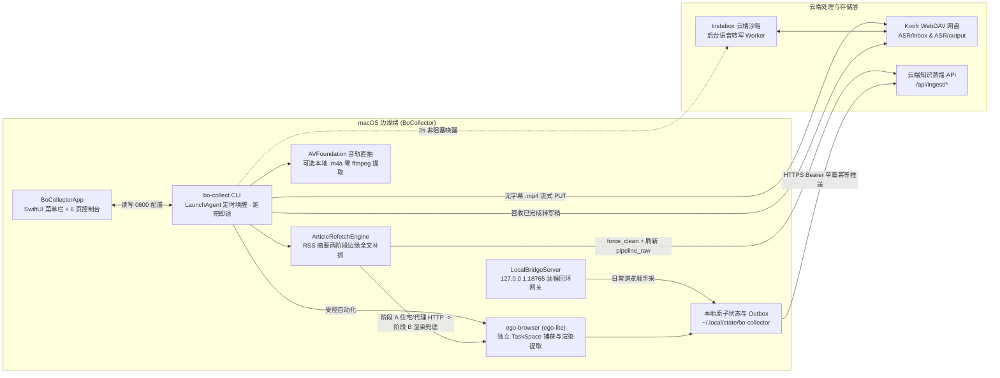

# BoCollector — macOS 原生边缘内容采集中心与守护工具

[](LICENSE)
[](Package.swift)
[](Package.swift)

**BoCollector** 是一款专为 macOS 14+ 打造的 **100% 纯 Swift 原生（SwiftUI 菜单栏应用 + 可视化配置中心 + 超轻量守护 CLI）** 边缘内容采集与全文补抓工具。

它负责在个人 Mac 上以极低资源开销完成需要本机住宅网络、系统代理（Surge/Clash）或真实浏览器登录态的边缘侧任务（**X 书签、抖音收藏、X 博主/列表监控、浏览器油猴被动桥接、云端摘要型 RSS 边缘全文补抓**）及无字幕视频流式投递，并将高信噪比结构化内容安全推送至云端知识蒸馏服务（如 `bo-distiller`）——**无需在本机部署 Python、MySQL、FastAPI 或 `ffmpeg`**。

---

## 架构概览



---

## 核心特性

### 1. 零外部运行时的双形态原生架构
- **`BoCollectorApp`（约 2.6 MB）**：常驻 macOS 右上角菜单栏（`MenuBarExtra`），平时不占用 Dock 栏；打开「控制中心与配置」窗口时自动切换常规焦点模式，提供完整的原生表单编辑、粘贴、连通性自检、RSS 边缘补抓触发与实时日志查看。
- **`bo-collect`（约 1.5 MB）**：内嵌于 `BoCollector.app/Contents/MacOS/bo-collect` 的纯原生命令行程序，由 macOS `LaunchAgent`（`com.bo.collector`）按设定间隔（默认 `1800s`）唤醒增量同步，**跑完即退，平时 0 常驻内存**；即使退出菜单栏界面也不影响后台定时采集。

### 2. 五路边缘采集与全文补抓能力全内置
- **X 书签 (`x_bookmarks`)**：
  - 驱动 `ego-browser` 在独立 TaskSpace 被动拦截 GraphQL `Bookmarks` 报文（含 DOM 兜底与 `domcontentloaded` 自动退避重试）。
  - 完整解析长推文（`note_tweet`）、引用推文（`quoted_status_result`）、X Article 长文区块，并支持对纯图/信息图推文调用多模态视觉模型（VLM）提取结构化 Markdown。
- **抖音收藏 (`douyin`)**：
  - 支持抓取全部收藏或指定收藏夹 ID，自动识别图文笔记（VLM 提取卡片正文）与视频原生 JSON/VTT 字幕。
  - 针对**无原生字幕口播视频**支持双通道语音转写：
    1. **Koofr WebDAV + 云端沙箱（推荐，传完即可合盖关机）**：通过 `URLSession` 文件流将 `.mp4` 直接 `PUT` 至 Koofr 网盘（支持 `HEAD` 体积校验免重传），随后发送 2 秒非阻塞唤醒信号交由云端沙箱异步转写，下轮自动回收文稿并清理网盘原视频。
    2. **OpenAI 兼容 ASR API 直转**：使用 macOS 原生 `AVFoundation` 直接从视频提取 `.m4a` 音轨（无需安装 `ffmpeg`），上传至任意兼容 `/audio/transcriptions` 的语音接口。
- **X 指定用户与列表监控 (`x_monitor`)**：
  - 支持自动合并云端启用监控博主列表与本地附加 `@handle`，同时支持**纯绑定 X List 链接/ID 自动发现成员模式**（无需手动维护用户名单，一页完成批量巡检）。
  - 内置置顶推文（`TimelinePinEntry`）防截断保护、转推/外部回复/超短无附件碎碎念高信噪比过滤，以及单轮 VLM 提取预算控制（优先最新推文）。
- **云端摘要型 RSS 第 2 级边缘全文补抓 (`rss`)**：
  - 自动向云端拉取服务端直抓受阻（如数据中心 IP 被拒或需前端 JS 渲染）的 `pending_refetch_articles` 队列。
  - **两阶段递进提取**：阶段 A 优先复用本机住宅网络/代理执行轻量 HTTP 抓取并清洗为结构化 Markdown；若遇动态渲染页则自动回退阶段 B，在独立 `ego-browser` TaskSpace 提取渲染后可读 DOM 正文。
  - 内置最多 3 次尝试上限（`exhausted` 防死循环保护）与反爬安全红线（遇验证码挑战立即跳过绝不强行绕过），补齐全文后同步刷新 `pipeline_raw` 并以 `force_clean: true` 回写云端触发重新清洗蒸馏。
- **L2 油猴本地桥接网关 (`127.0.0.1:18765`)**：
  - 基于 Apple `Network.framework` (`NWListener`) 构建的纯本地回环 HTTP 服务，仅监听 `127.0.0.1`。
  - 直接提供 `/api/ingest/userscript.user.js` 脚本安装地址与 `/api/ingest/raw` 鉴权接口，日常刷 X 或抖音时即可顺手被动入库。

### 3. 断点续传 Outbox、防超时分片与自愈防打扰
- **本地 `outbox` 先落盘后推送**：所有新捕获内容先原子写入本地 `state.json` 的 `outbox`，再按单篇逐条推送并与云端 `recent_ids` 幂等对账，彻底规避反向代理（如 Cloudflare 100s）长耗时 LLM 清洗断连问题，断网或遇 `HTTP 422` 队列忙时自动留存下轮续传。
- **三级异常分流**：
  1. **网络/代理瞬时抖动**（如 `ERR_TIMED_OUT`、`URLError`、`502/503/504`）：归类为 `retry_wait` 静默等待下轮重试，不误报故障。
  2. **登录态过期 / 验证码挑战**：立即进入 `auth_paused` 保护态并发送 macOS 系统通知，调用 `ego-browser` `handOff()` 交由人工在可见浏览器完成后一键恢复（绝不自动绕过验证码）。
  3. **连续代码级异常**：自动对日志中的 URL 密码、Query 密钥与 Bearer Token 脱敏，生成 `incident.json` 并可联动触发本地 Orca 自愈任务。

---

## 目录结构

```text
bo-collector/
├── Package.swift                      # Swift 6.0 Package 定义（macOS 14+，零第三方依赖）
├── Resources/
│   └── AppIcon.icns                   # 多分辨率 Retina 原生应用图标
├── Sources/
│   ├── BoCollectorCore/               # 核心采集、解析、网络、配置与自愈引擎库
│   │   ├── Config.swift               # 0600 JSON 配置存储、旧版 env/YAML 无损迁移
│   │   ├── Models.swift               # 跨端文章载荷、水位线、ASR 与 RSS 补抓状态模型
│   │   ├── JSONValue.swift            # 线程安全动态 JSON 值编解码与遍历工具
│   │   ├── HTTPClient.swift           # 系统/Surge/自定义代理感知的同步网络层
│   │   ├── BrowserClient.swift        # ego-browser 自动化脚本生成、重试与网页正文提取封装
│   │   ├── Parsers.swift              # X 书签 GraphQL、抖音多模态与 AVFoundation 音轨提取
│   │   ├── VLMClient.swift            # 多模态视觉模型图片/信息图结构化提取客户端
│   │   ├── XMonitorEngine.swift       # X 博主/List 监控巡检、高信噪比过滤与水位推进
│   │   ├── ArticleRefetchEngine.swift # 云端摘要型 RSS 两阶段（HTTP -> ego-browser）全文补抓引擎
│   │   ├── KoofrAsrClient.swift       # Koofr WebDAV 流式上传、XML 解析与云端沙箱唤醒
│   │   ├── SyncEngine.swift           # 增量同步编排、Outbox 续传、ASR 回收、RSS 补抓与 Doctor 自检
│   │   ├── LocalBridgeServer.swift    # NWListener 本地油猴回环网关与动态脚本生成
│   │   └── Healer.swift               # 敏感信息脱敏、验证暂停保护、自愈与 LaunchAgent 管理
│   ├── BoCollectCLI/                  # bo-collect 原生命令行入口
│   │   └── main.swift
│   └── BoCollectorApp/                # SwiftUI 菜单栏常驻端与可视化控制中心
│       ├── BoCollectorApp.swift
│       ├── AppModel.swift
│       ├── MenuBarView.swift
│       └── ControlCenterView.swift
├── Tests/
│   └── BoCollectorTests/              # 单元测试套件（配置迁移、解析器、RSS 补抓、Outbox、桥接网关等）
└── scripts/
    ├── build_app.sh                   # Release 编译、App Bundle 组装、签名与本地安装脚本
    └── generate_icon.swift            # 纯 Swift 原生矢量绘制生成 AppIcon.icns
```

---

## 环境要求与快速开始

### 环境要求
- **操作系统**：macOS 14.0 (Sonoma) 或更高版本（Apple Silicon / Intel 均支持）
- **编译工具链**：Xcode 16+ 或 Swift 6.0 Command Line Tools
- **可选外部协作组件**：
  - `ego-browser` CLI：用于执行 X 书签、抖音收藏、X 博主/列表本地登录态抓取及动态网页全文渲染兜底
  - Koofr WebDAV 账号 + `instabox` CLI（或任意 OpenAI 兼容语音 API）：用于无字幕抖音视频语音转写

### 编译、测试与安装

```bash
git clone https://github.com/zhangsubo/bo-collector.git
cd bo-collector

# 1. 运行全部单元测试
swift test

# 2. 编译 Release 原生应用包并安装至 ~/Applications/BoCollector.app
#    同时自动创建命令行软链 ~/.local/bin/bo-collect（若仅打包不安装可传 --no-install）
./scripts/build_app.sh

# 3. 启动菜单栏应用，打开「控制中心与配置...」填写云端地址与鉴权信息
open ~/Applications/BoCollector.app
```

> 确保 `~/.local/bin` 已加入你的 `PATH` 环境变量，即可在任意终端直接运行 `bo-collect`。

---

## 配置存储与安全机制

所有边缘采集配置与凭据统一存储在本地私有文件，开箱即支持无头后台定时运行：

| 路径 | 权限 | 用途说明 |
| :--- | :---: | :--- |
| `~/.config/bo-collector/config.json` | `0600` | 主配置文件（云端地址、Token、代理模式、X/抖音/监控/RSS 补抓参数、Koofr/ASR/VLM 密钥等）。采用原子临时文件写入 + `fchmod 0600`，避免后台 `LaunchAgent` 在锁屏状态下因读取 macOS Keychain 弹窗阻塞。 |
| `~/.local/state/bo-collector/state.json` | `0600` | 各平台已入库去重 ID 集合（`known`）、待续传队列（`outbox`）、ASR 回收与 RSS 补抓进度及自愈状态；内置云端目标 URL SHA-256 校验，防止切换环境混用状态。 |
| `~/.local/state/bo-collector/logs/` | `0700` | 运行日志 `collector.log` 与 `launchd.log`（超过 2 MB 自动轮转，文件权限 `0600`）。 |
| `~/Library/LaunchAgents/com.bo.collector.plist` | `0644` | 原生 `bo-collect sync` 定时调度配置。 |

可通过环境变量 `BO_COLLECTOR_CONFIG`、`BO_COLLECTOR_STATE_DIR`、`BO_COLLECTOR_CACHE_DIR` 覆盖默认路径（便于隔离测试或多实例运行）。

---

## 命令行参考 (`bo-collect`)

```bash
# 状态与自检
bo-collect status                                 # 输出 JSON 格式水位线、outbox、ASR、RSS 补抓与 LaunchAgent 状态
bo-collect doctor                                 # 全链路连通性诊断（配置文件权限 / ego-browser / 云端 API / Koofr / VLM）

# 增量采集、RSS 全文补抓与语音稿回收
bo-collect sync                                   # 执行一轮完整增量同步（ASR 回收 + RSS 全文补抓 + 所有已启用采集源）
bo-collect sync --source x_bookmarks              # 仅同步指定源（支持 all / x_bookmarks / douyin / x_monitor / rss）
bo-collect sync --limit 10                        # 临时覆盖单轮最大捕获/补抓条数
bo-collect refetch [--limit 20]                   # 仅执行云端待补抓 RSS 摘要的边缘全文补齐与回写
bo-collect harvest                                # 仅从 Koofr WebDAV 回收已完成转写文稿并清理网盘原视频
bo-collect harvest --cloud                        # 触发云端 /api/ingest/harvest-asr 执行远端回收
bo-collect resume --sync-now                      # 在浏览器完成人工登录/验证后解除 auth_paused 并立即续跑

# 历史存量慢速补采
bo-collect backfill --until-end                   # 分批慢速回溯历史收藏，支持礼貌休眠防风控
bo-collect stop                                   # 写入安全停止标记，当前批次完成后优雅退出

# 本地油猴桥接与定时服务管理
bo-collect bridge --port 18765                    # 在前台独立运行 L2 油猴本地回环网关
bo-collect service install --interval 1800        # 注册并启动每 30 分钟运行一次的原生 LaunchAgent
bo-collect service status                         # 查看 LaunchAgent 加载与最近退出码
bo-collect service uninstall                      # 停止并卸载 LaunchAgent

# 旧版配置与水位线无损迁移
bo-collect import-config ~/Code/bo-distiller      # 从旧版 bo-distiller 目录导入 .env / config.yaml 边缘配置
bo-collect import-state /path/to/old/state.json   # 合并历史已采集 ID 水位线，避免重复抓取
```

---

## 云端接收端接口契约

`BoCollector` 通过标准 HTTPS JSON + `Authorization: Bearer <REMOTE_INGEST_TOKEN>` 与云端接收端通信，任何实现以下 3 个端点的后端服务均可直接对接：

1. **`GET /api/ingest/state?source_type=<platform>&source_name=<name>`**
   - 返回云端最近已入库的 `recent_ids`、待转写抖音条目 `pending_asr_articles`（`source_type=douyin`）、待边缘全文补抓条目 `pending_refetch_articles`（`source_type=rss`），以及 `x_monitor` 下的 `monitored_users` 与 `x_monitor_config`。
2. **`POST /api/ingest/articles`**
   - 接收标准化 `ArticlePayload` 数组、`recent_ids`、`clean` / `force_clean` 清洗开关及可选的 `x_monitor_user_states` 水位更新；异步正文升级（ASR 口播稿回填、RSS 边缘全文补齐）会同步更新 `metadata.pipeline_raw` 并传 `force_clean: true`；返回 `{"status": "ok", "saved": N, "duplicates": M, "save_failed": 0}`。
3. **`POST /api/ingest/harvest-asr`** *(可选)*
   - 供 `bo-collect harvest --cloud` 触发云端主动拉取网盘转写结果。

---

## 开源协议

本项目基于 [MIT License](LICENSE) 开源。
